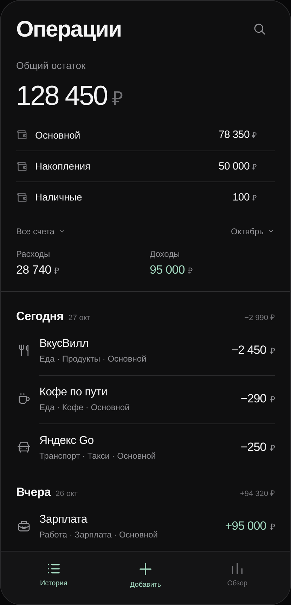

# Чесно

Минималистичный трекер расходов и доходов для iPhone. Сейчас готов интерактивный дизайн-прототип с выбранным тёмным оформлением.

На главной показаны все счета, их текущие остатки и общий итог. Доступны добавление расходов и доходов, обязательные категории и подкатегории, заметки, история, поиск и статистика. Нажатие на счёт фильтрует операции; общий остаток остаётся суммой всех счетов.



## Запуск

Откройте `design/index.html` в браузере. Файлы `index.html`, `styles.css` и `app.js` должны оставаться рядом. Установка зависимостей не требуется.

Для запуска через локальный HTTP-сервер из корня репозитория:

```sh
python3 -m http.server 8000 --directory design
```

Откройте в браузере адрес сервера на порту `8000`.

## Текущее состояние

Операции демонстрационные и хранятся в памяти вкладки до перезагрузки. Демонстрационная дата — 27 октября 2026 года. Суммы рассчитываются в целых копейках.

Следующий этап: постоянное хранение в IndexedDB, офлайн-режим через Service Worker, установка PWA на iPhone, резервные копии и переводы между счетами.

[Описание прототипа](design/README.md)
